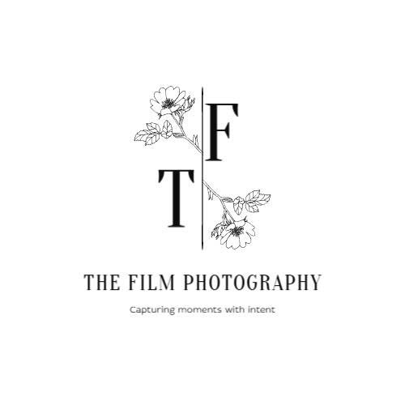

<div align="center">
  
  <h1># Film Photo Platform — Mobile app</h1>
  <h3>The Ultimate Hub for Film Photography Enthusiasts</h3>

  <p>
    <a href="https://flutter.dev/"></a>
    <a href="https://dart.dev/"></a>
    <a href="https://dotnet.microsoft.com/en-us/apps/aspnet"></a>
    <a href="https://github.com/GFA26SE169_FA26SE091"></a>
  </p>
</div>

---

## 📸 Introduction
**AnalogAI** (Film Photography Platform) is a comprehensive ecosystem designed specifically for the film photography community. It bridges the gap between traditional photography processes and modern technology by connecting **Photographers** and **Film Experts**. 

Whether you need to book a darkroom, rent vintage equipment, seek expert advice on film processing, or simply restore old negatives using AI, AnalogAI provides a seamless, all-in-one mobile experience.

## ✨ Key Features
*   **Booking System:** Photographers can easily book Studios, Darkrooms, and vintage camera equipment.
*   **Expert Q&A & Scheduling:** Connect with Film Experts to schedule 1-on-1 consultations or attend exclusive workshops.
*   **AI Tools Hub:** Enhance and restore old, damaged film scans using integrated AI restoration tools.
*   **Community Forum:** Share knowledge, film recipes (like Push/Pull processing), and showcase your analog portfolio.
*   **Smart Notifications:** Real-time local and push notifications for booking confirmations and application statuses.

## 📱 App Screenshots
*(Add screenshots of your App here: Login, Home, Booking Flow, Community)*

## 🏗️ Project Structure
The Flutter app follows a scalable **Feature-First Architecture** with Clean Architecture principles:

```text
lib/
├── app/                  # Main entry point & app initialization
├── core/                 # Shared resources across the app
│   ├── network/          # API Client & Interceptors (Dio/Http)
│   ├── services/         # Device services (Notifications, Storage)
│   ├── theme/            # App Colors, Typography, Light/Dark modes
│   ├── utils/            # Helper functions (Formatters, Image Utils)
│   └── widgets/          # Global reusable UI components
└── features/             # App features modules
    ├── ai_tools/         # AI Restoration & Assistant screens
    ├── auth/             # Login, Register, Forgot Password
    ├── booking/          # Studio/Equipment Booking Flow & API Services
    ├── community/        # Blog posts, Forums, Interactions
    ├── expert/           # Expert applications, Workshops, Q&A
    ├── home/             # Main Navigation & Dashboard
    ├── notifications/    # In-app notifications
    └── profile/          # User digital collections & settings
```

## 🛠️ Tech Stack
*   **Frontend:** Flutter (Dart)
*   **Backend:** ASP.NET Core 9.0 Web API, Entity Framework Core (PostgreSQL/SQL Server)
*   **State Management & UI:** `StatefulWidget`, ValueNotifiers
*   **Network:** `http` with Singleton ApiClient
*   **Local Storage/Database:** `sqflite`, Shared Preferences
*   **Animations:** `flutter_animate`, `carousel_slider`
*   **Notifications:** `flutter_local_notifications`

## 🚀 Getting Started

### Prerequisites
- [Flutter SDK](https://docs.flutter.dev/get-started/install) (Version >= 3.13)
- [Android Studio](https://developer.android.com/studio) or VS Code
- Android Emulator or a Physical Device
- Backend Server running locally (Clone from the [Backend Repository](https://github.com/GFA26SE169_FA26SE091_CapstoneProject))

### Installation
1. **Clone the repository:**
   ```bash
   git clone <your-repository-url>
   cd film_photography_platform
   ```

2. **Install dependencies:**
   ```bash
   flutter pub get
   ```

3. **Configure Backend URL (Optional):**
   The app is pre-configured to connect to `http://10.0.2.2:5038` (Android Emulator to local ASP.NET Core). If your backend runs on a different IP/Port, update the `baseUrl` inside:
   `lib/core/network/api_client.dart`

4. **Run the App:**
   ```bash
   flutter run
   ```

### Default Test Accounts
If the backend is not running, the App's **Offline Mock Mode** will activate automatically using these credentials:
*   **Photographer:** `photographer.demo@filmbooking.local`
*   **Expert:** `expert.demo@filmbooking.local`
*   **Password:** `FilmDemo2026!` (for all)

## 🎯 Capstone Information
*   **Project Name:** AnalogAI - A Booking and Consultation Platform for Film Photography
*   **Domain:** Service Booking / Social Community / AI Integration
*   **Target Users:** Film Photographers, Studio/Lab Owners, Photography Experts.

---
*Developed with ❤️ by the Capstone Team.*
